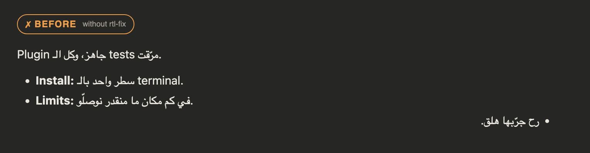
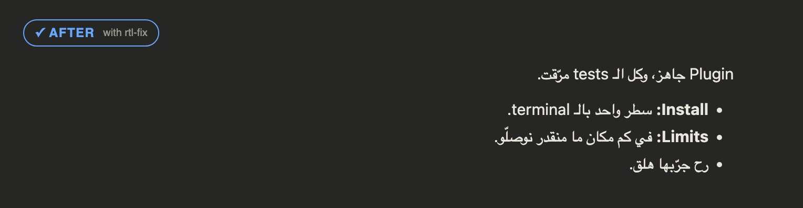
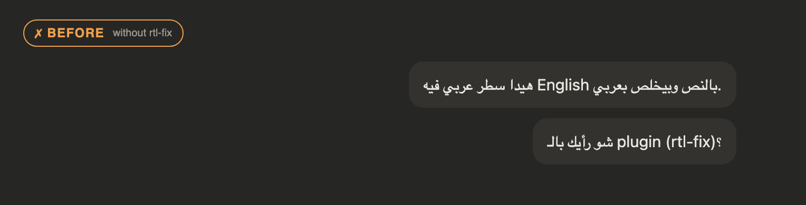
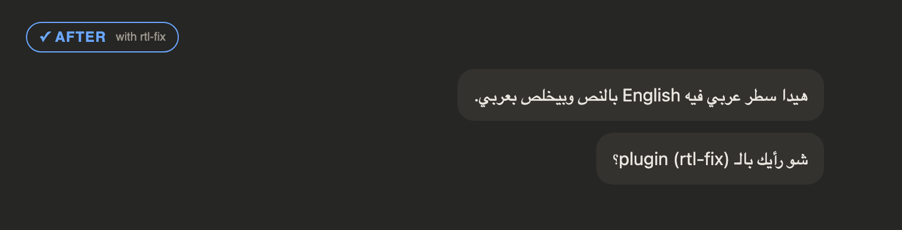
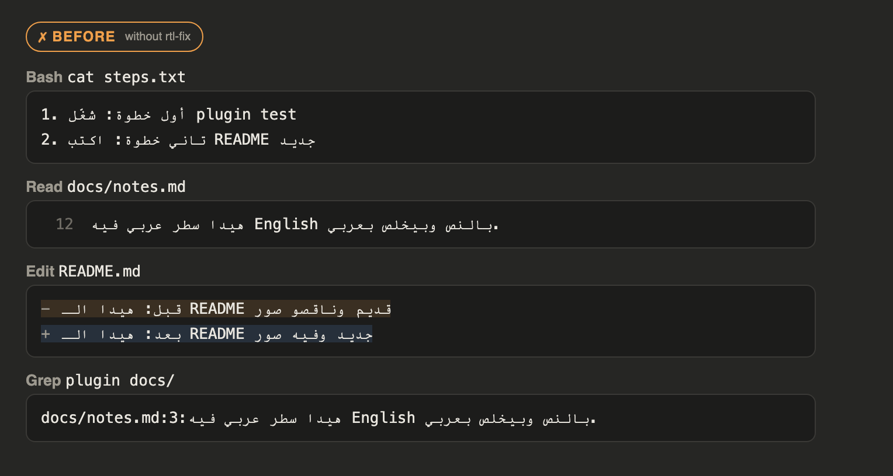
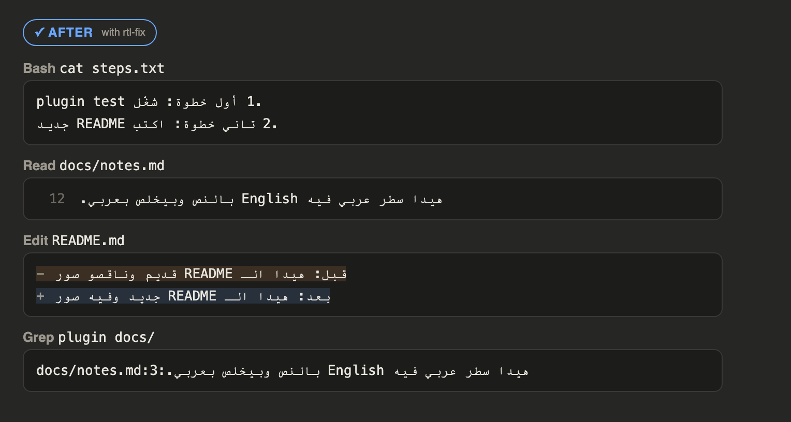

# rtl-fix

**Arabic reads right-to-left in Claude Code.**

Claude Code lays text out left-to-right and picks a line's direction from its first
strong character. For Arabic that means reversed word order in mixed lines, lists on the
wrong side, and `�` boxes in tool output. `rtl-fix` is a plugin that fixes every place a
plugin can reach: Claude's replies, your own messages and tool output (Bash, Read, Edit
diffs, grep).

**بالعربي:** هالإضافة بتخلّي النص العربي ينقرا صح من اليمين لليسار بـ Claude Code: بردود
Claude، وبرسائلك انت، وبنتايج الأدوات (Bash وRead وEdit وgrep). الكلمات
الإنكليزي والأرقام والأقواس بتضل بمحلها بنص الجملة العربي. هي بتغيّر شكل العرض بس، مش
المحادثة نفسها.

### Tables

A markdown table in an Arabic reply runs right-to-left: the table takes its direction from its first cell, so each row's first cell gets an RLM, and Arabic cells are wrapped in an RLI…PDI isolate (cells keep a fixed direction of their own).

## Install

In a terminal Claude Code session:

```
/plugin install rtl-fix --marketplace aurelius86/rtl-fix
```

Answer `y` to add the marketplace, then pick the user scope. It also works in the
desktop app's Code tab once installed from a terminal at the user scope.

## Before and after

The images below are generated from the plugin's own functions run on sample text
(see [Develop](#develop)). They mimic the dark chat view; they are not screenshots of the
app, whose window can't be captured by script.

### Claude's replies

A line takes its direction from its first strong character, and a list takes its
direction from its first item. So a line that starts with `Plugin` or `**Install:**` is
laid out left-to-right, and one English item flips the whole list. The plugin puts an
invisible RLM (U+200F) after the markdown marker of each Arabic line, and on every list
item of a message that has Arabic.

| Before | After |
|---|---|
|  |  |

### Your messages

Your message row is a fixed left-to-right box, so `Arabic 1 English Arabic 2` comes out
as `Arabic 2 English Arabic 1`. Each Arabic line is wrapped in an RLI…PDI isolate
(U+2067…U+2069); the app still draws the row, bubble and attached images included.

| Before | After |
|---|---|
|  |  |

### The question dialog

Since Claude Code 2.1.299 the dialog lays Arabic out right-to-left itself, so rtl-fix
leaves it alone (1.4.3). Up to 1.4.2 it pre-ordered the dialog's mixed lines, which on
2.1.299 made them read from the middle.

### Tool output: Bash, Read, Edit diff, grep

Tool output is a fixed-width left-to-right block, so mixed lines come out reversed. Each
line that is mostly Arabic is pre-ordered for display. Read's line numbers and grep's
`path:line:` prefix stay first and untouched, and a list marker (`1.`, `-`) moves to the
end of the line, behind an LRM so the digit doesn't join the Arabic run. Lines that are
mostly English are left alone.

| Before | After |
|---|---|
|  |  |

## What it changes

Display only. The stored conversation, the files on disk and what the model reads are
untouched. Lines without Arabic and code blocks are left alone.

| Where | Technique |
|---|---|
| Replies | RLM after the markdown marker of Arabic lines and of every list item in an Arabic message; in an English message, an LRM on a list item that starts in Arabic so the list stays left-to-right |
| Your messages | RLI…PDI around each Arabic line |
| Tool output | Pre-ordered mostly-Arabic lines (`orderOutput`), prefixes kept |

## Limits

- **The prompt input box** (where you type) belongs to the app; a plugin can't reach it.
- **The file viewer pane** is the app's own too.
- **The plan pane** draws the plan from what Claude wrote in the Write or Edit of the plan file
  (not from the file on disk), in a fixed left-to-right box that ignores an RLM. So rtl-fix
  refuses a write to `~/.claude/plans/*.md` that has bare Arabic lines and hands Claude the
  same text with each Arabic line wrapped in RLI…PDI (list markers inside the wrapper, two
  trailing spaces). Claude writes it again and the pane reads right-to-left; the lines stay
  aligned to the left edge.
- Built on Claude Code 2.1.293; checked again on 2.1.299 (desktop Code tab). The plugin API
  is early access and may change.

## Develop

```
claude plugin validate .
claude plugin test .
```

The logic is in `hooks/rtl.ts` (`fixText`, `isolateLine`, `visualOrder`, `orderOutput`);
the `ui.render` hooks are in `hooks/register.tsx`. The images in `docs/` come from a small
static HTML page that draws each sample twice (left-to-right as the app does, and with the
plugin's output), rendered with headless Chrome.

## License

MIT
